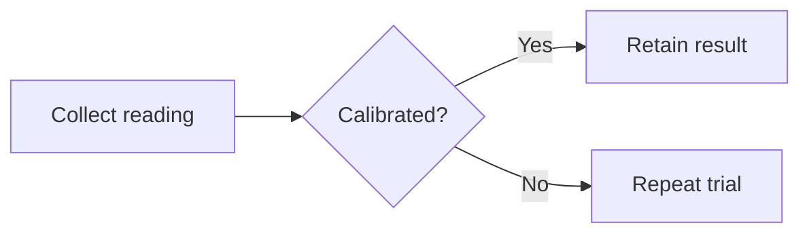

# Obsidian Markdown syntax

Use this guide to draft notes and explain syntax. Examples are original,
illustrative text, not evidence that the referenced files exist.
Target: kotonoha 0.5.3 development; checked 2026-11-05.

## Internal links and block targets

| Purpose | Example |
|---|---|
| Note | `[[Research log]]` |
| Vault-relative note | `[[Research/Research log]]` |
| Display alias | `[[Research log\|Observations]]` |
| Heading | `[[Research log#Open questions]]` |
| Heading in this note | `[[#Open questions]]` |
| Block | `[[Research log#^trial-7]]` |
| Markdown-style internal link | `[Observations](Research%20log.md)` |

Use existing Vault conventions for extensions and link style. Markdown link
destinations with spaces need URL encoding or angle brackets. In a table cell,
escape a wikilink's alias separator: `[[Research log\|Observations]]`.
Do not change the stored filename just to simplify a link.

Put a block identifier at the end of a paragraph:

```markdown
The second trial needs an independent measurement. ^trial-7
```

For a list or quote, separate its identifier from the block with a blank line:

```markdown
> Record the observation before drawing a conclusion.

^observation-rule
```

Block IDs use letters, digits and hyphens. Preserve existing IDs; duplicate
headings or same-named notes may make resolution ambiguous. Syntax alone
cannot prove which note an abbreviated link resolves to.

## Embeds and external resources

| Content | Example |
|---|---|
| Whole note | `![[Research log]]` |
| Heading or block | `![[Research log#Open questions]]`, `![[Research log#^trial-7]]` |
| Image width | `![[apparatus.png\|480]]` |
| Image dimensions | `![[apparatus.png\|480x320]]` |
| PDF page | `![[protocol.pdf#page=2]]` |
| Audio or video | `![[interview.mp3]]`, `![[trial.mp4]]` |
| Base file | `![[Experiments.base]]` |
| Remote image | `` |

An embed references a file; it does not copy it or authorize reading its
contents. Media support depends on Obsidian and the operating system.
Remote images and HTML embeds may contact external services when rendered.
Do not fetch them, insert tracking URLs, or claim offline rendering.
Embedded `base` code blocks are outside the standalone Bases editor's scope.

## Callouts, folding and nesting

```markdown
> [!warning]- Measurement not verified
> Keep the raw reading until a second observer checks it.
>
> > [!question] Next check
> > Was the sensor calibrated?
```

The `-` folds a callout initially; `+` makes it foldable and initially expanded.
Omit either marker for a regular callout. Quote every body line, including blank
lines. Common built-in types include `note`, `abstract`, `info`, `todo`, `tip`,
`success`, `question`, `warning`, `failure`, `danger`, `bug`, `example` and
`quote`. Aliases include `summary`/`tldr`, `hint`/`important`, `check`/`done`,
`help`/`faq`, `caution`/`attention`, `fail`/`missing`, `error` and `cite`.
Custom types may depend on CSS; do not promise their icons or appearance.

## Properties and tags

Properties belong in one YAML frontmatter block at the start of the note:

```yaml
---
title: "Calibration trial"
aliases:
  - "Sensor trial"
tags:
  - research/calibration
reviewed: false
sample_count: 7
observed: 2026-11-05
recorded: 2026-11-05T09:30:00
related:
  - "[[Research log]]"
---
```

Obsidian property types include text, list, number, checkbox, date, datetime
and tags. A property name has one application-level type across the Vault;
do not infer permission to change that type from one file. `aliases`, `tags`
and `cssclasses` use lists. Quote text that resembles a boolean, number or date
when it is meant as text, and quote wikilinks in YAML.
Nested objects are YAML but are not generally editable as ordinary properties
in the Properties UI. Preserve unknown fields rather than flattening them.

Inline tags use `#research` or `#research/calibration`. Tags cannot be
numbers-only or contain spaces; letters, digits, underscores, hyphens and
slashes are supported. Frontmatter tag values normally omit `#`.
Do not turn every title into a tag or rewrite tags without authority.

## Comments, highlights and footnotes

```markdown
The measurement is ==provisional==. %% Internal review is pending. %%

The observer recorded a correction.[^correction]

[^correction]: The raw reading remains in the source log.
```

Multiline comments place `%%` around the hidden block. Comments are hidden in
Reading view, not encrypted or excluded from model context.
Inline footnotes use `^[A short qualification.]`. Preserve footnote identifiers
and definitions together when editing.

## Math, diagrams and search blocks

Use `$a^2 + b^2 = c^2$` for inline math and a pair of `$$` delimiters for display
math. Do not rewrite mathematical notation as prose.

````markdown


```query
tag:#research/calibration
```
````

Mermaid is not JSON Canvas. Syntax does not establish layout or successful
rendering. A `query` block may show results from beyond the note when opened;
disclose that scope and do not run the search without read authority.
Community-plugin blocks such as Dataview or Templater require separate
dependencies and execution permission.

## Core Templates versus Knap

Core Templates understands `{{title}}`, `{{date}}`, `{{time}}` and formatted
date/time variants such as `{{date:YYYY-MM-DD}}`. It expands them when the user
inserts a template, not whenever a finished note opens.
Use the shared `tech-writer/assets/templates/obsidian.md` template.

`knap` is a separate external renderer with JSON/CSV inputs, filters and logic.
Do not feed a core Templates note to Knap and assume identical expansion.
Neither language is community-plugin JavaScript.

## Syntax and rendering references

- [Obsidian Flavored Markdown](https://help.obsidian.md/obsidian-flavored-markdown)
- [Internal links](https://help.obsidian.md/links)
- [Embedding files](https://help.obsidian.md/embeds)
- [Callouts](https://help.obsidian.md/callouts)
- [Properties](https://help.obsidian.md/properties)
- [Tags](https://help.obsidian.md/tags)
- [Templates](https://help.obsidian.md/templates)
